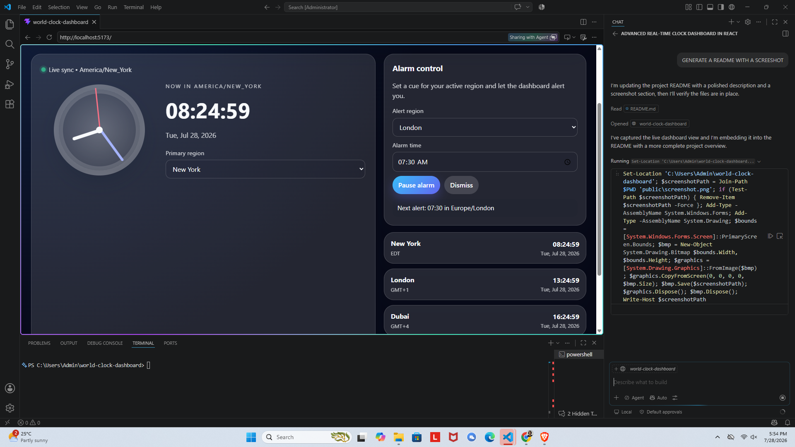

# World Clock Dashboard

A modern React-based dashboard for tracking global time zones, live analog and digital clocks, and alarms in a single polished interface.

## Screenshot



## Features
- Live analog and digital clock rendering
- Multiple world time zones with instant updates
- Alarm controls with region-based alerts
- Responsive dashboard layout for desktop and mobile
- Dynamic UI controls for 12/24-hour time, seconds, theme, and compact mode

## Tech Stack
- React
- Vite
- CSS

## Run locally
```bash
npm install
npm run dev
```

## Project Structure
```text
src/
  App.jsx      # Main dashboard UI and live clock logic
  App.css      # Visual design and responsive layout
  index.css    # Global styles
```

## Demo
Open the app in your browser at the local Vite URL displayed after running the dev server.
